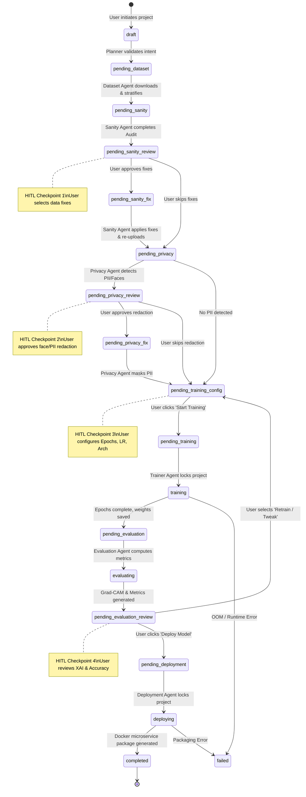

# 🐝 AgentHive: Complete Project Architecture & System Technical Guide

> **Official Project Title:** AGENTHIVE: A Trust-Aware Multi-Agent AutoML Framework for Automated Model Generation and Deployment  
> **Institution:** Department of Computer Science & Engineering, Gopalan College of Engineering and Management (Affiliated to Visvesvaraya Technological University - VTU), Bangalore, India  
> **Document Version:** 2.0 (Production Architecture & Implementation Manual)  
> **Last Updated:** October 2026

---

## 📑 Table of Contents

1. [Executive Summary & Core Value Proposition](#1-executive-summary--core-value-proposition)
2. [High-Level System Architecture](#2-high-level-system-architecture)
3. [Technology Stack Across All Tiers](#3-technology-stack-across-all-tiers)
4. [The 7-Agent Autonomous Ecosystem](#4-the-7-agent-autonomous-ecosystem)
   - [4.1 Planner Agent (Port 8001)](#41-planner-agent-port-8001)
   - [4.2 Dataset Agent (Port 8002)](#42-dataset-agent-port-8002)
   - [4.3 Data Sanity Agent (Port 8004)](#43-data-sanity-agent-port-8004)
   - [4.4 Privacy (PII) Agent (Port 8005)](#44-privacy-pii-agent-port-8005)
   - [4.5 Trainer Agent (Port 8003)](#45-trainer-agent-port-8003)
   - [4.6 Evaluation & Explainable AI (XAI) Agent](#46-evaluation--explainable-ai-xai-agent)
   - [4.7 Deployment Agent (Port 8007)](#47-deployment-agent-port-8007)
5. [Orchestration, Gateway & Frontend Infrastructure](#5-orchestration-gateway--frontend-infrastructure)
   - [5.1 Model Context Protocol (MCP) Server (Port 8000)](#51-model-context-protocol-mcp-server-port-8000)
   - [5.2 Express.js Backend API Gateway (Port 4000)](#52-expressjs-backend-api-gateway-port-4000)
   - [5.3 Frontend Single-Page Application (Port 5173)](#53-frontend-single-page-application-port-5173)
6. [End-to-End Pipeline State Machine & Workflow](#6-end-to-end-pipeline-state-machine--workflow)
7. [Database Schema & Data Contracts (Supabase PostgreSQL)](#7-database-schema--data-contracts-supabase-postgresql)
8. [Multimodal Support (Vision, Tabular, Text)](#8-multimodal-support-vision-tabular-text)
9. [Human-in-the-Loop (HITL) Trust & Governance System](#9-human-in-the-loop-hitl-trust--governance-system)
10. [Explainable AI (XAI) & Dynamic Justification Reports](#10-explainable-ai-xai--dynamic-justification-reports)
11. [Live In-Browser Model Testing & Inference Engine](#11-live-in-browser-model-testing--inference-engine)
12. [Containerization & Docker Orchestration](#12-containerization--docker-orchestration)
13. [Installation, Environment Setup & Operational Runbook](#13-installation-environment-setup--operational-runbook)
14. [Troubleshooting & Diagnostic Utilities](#14-troubleshooting--diagnostic-utilities)

---

## 1. Executive Summary & Core Value Proposition

Machine learning model development traditionally demands deep domain expertise across data engineering, data cleaning, architecture design, hyperparameter optimization, model auditing, and deployment infrastructure. While standard Automated Machine Learning (AutoML) tools accelerate model search, they typically operate as **opaque black boxes**:
- They fail silently or produce poisoned models when datasets contain corrupted, duplicate, or blurry samples.
- They risk severe legal violations (e.g., GDPR, HIPAA) by blindly ingesting Personally Identifiable Information (PII) such as faces, SSNs, credit card numbers, and emails into model weights.
- They generate opaque neural networks without visual or statistical explanations.
- When LLMs are prompted to write raw PyTorch training scripts from scratch, they frequently hallucinate invalid hyperparameters, broken tensor dimensions, or non-existent library APIs.

**AgentHive** eliminates these vulnerabilities through a **Trust-Aware Multi-Agent Architecture**:
1. **Parameterized Template Architecture:** Instead of asking LLMs to generate hallucination-prone executable code, the LLM Planner outputs strict, structured JSON schemas. These schemas parameterize deterministic, hardened training and evaluation templates.
2. **7 Specialized Micro-Agents:** Each phase of the MLOps lifecycle is governed by an autonomous, isolated service running in its own runtime container.
3. **Four-Stage Human-in-the-Loop (HITL) Guardrails:** Non-technical domain experts retain oversight through interactive review panels for data sanity fixes, PII masking, hyperparameter overrides, and final deployment approvals.
4. **Multimodal Native:** Seamlessly accommodates **Computer Vision** (CNNs), **Tabular Data** (Tree Ensembles, XGBoost, Random Forest), and **Natural Language Text** (TF-IDF + LinearSVC/MultinomialNB).
5. **Native Explainability:** Gradient-weighted Class Activation Mapping (Grad-CAM) visualizes pixel regions driving CNN decisions, feature importance scores analyze tabular predictors, and Gemini LLMs generate dynamic Justification Reports.
6. **1-Click Containerized Deployment:** Automatically packages trained weights, label dictionaries, dynamic FastAPI REST servers, and Dockerfiles into a portable, production-grade microservice.

---

## 2. High-Level System Architecture

AgentHive is designed around a decoupled, event-driven microservices architecture where communication between the UI, agents, databases, and blob storage is brokered via the **Model Context Protocol (MCP)** and a central **Supabase State Engine**.

```mermaid
graph TB
    subgraph Client_Tier ["Client Tier (Browser)"]
        UI["React 18 Single Page App<br/>(Vite, Bootstrap, Framer Motion)"]
    end

    subgraph Gateway_Tier ["API Gateway Tier"]
        BE["Node.js Express Gateway (:4000)<br/>- Cookie Session Auth<br/>- Firebase Admin SDK<br/>- Multer Streaming Uploads"]
    end

    subgraph Orchestration_Tier ["Agent Orchestration Backbone"]
        MCP["Model Context Protocol (MCP) Server (:8000)<br/>- FastAPI Core<br/>- Google Gemini 3.5 Flash Client<br/>- GCS Blob Manager<br/>- Agent Dispatcher & State Coordinator"]
    end

    subgraph Agent_Swarm ["Autonomous Agent Swarm"]
        direction TB
        Agent1["1. Planner Agent (:8001)<br/>Intent Parser & Strategy Generator"]
        Agent2["2. Dataset Agent (:8002)<br/>Kaggle Harvester & Normalizer"]
        Agent3["3. Data Sanity Agent (:8004)<br/>Audit & Auto-Fix Engine"]
        Agent4["4. Privacy Agent (:8005)<br/>PII Scanner & Face Masker"]
        Agent5["5. Trainer Agent (:8003)<br/>PyTorch/Scikit-Learn Engine"]
        Agent6["6. Evaluation Engine (Integrated in :8003)<br/>Metrics & Grad-CAM XAI"]
        Agent7["7. Deployment Agent (:8007)<br/>FastAPI & Docker Packager"]
    end

    subgraph Persistence_Tier ["State & Storage Infrastructure"]
        DB[(Supabase PostgreSQL 15)<br/>- Projects & Datasets<br/>- Models & Realtime Logs<br/>- Users & Permissions]
        GCS[(Google Cloud Storage)<br/>- Raw & Sanitized Datasets<br/>- Model Checkpoints (.pth / .joblib)<br/>- Grad-CAM Heatmaps<br/>- Docker Deployment Packages]
        FBAuth["Firebase Authentication<br/>Google OAuth / Phone / Email"]
    end

    UI -->|"Session Cookie + REST Requests"| BE
    BE -->|"JWT Verification"| FBAuth
    BE -->|"Proxied API Calls"| MCP
    MCP -->|"Invoke Intent Parsing"| Agent1
    MCP -->|"Signed URLs / File I/O"| GCS
    MCP -->|"State Sync & Queries"| DB
    UI -.->|"Direct Signed URL Downloads"| GCS

    %% Autonomous Polling & Execution Loops
    Agent2 <-->|"Polls pending_dataset & Saves Metadata"| DB
    Agent2 -->|"Uploads Raw Archives"| GCS
    Agent3 <-->|"Polls pending_sanity / pending_sanity_fix"| DB
    Agent3 <-->|"Reads Raw & Writes Sanitized Data"| GCS
    Agent4 <-->|"Polls pending_privacy / pending_privacy_fix"| DB
    Agent4 <-->|"Reads Sanitized & Writes Masked Data"| GCS
    Agent5 <-->|"Polls pending_training & Updates Status"| DB
    Agent5 <-->|"Downloads Data & Uploads Checkpoints"| GCS
    Agent6 <-->|"Polls pending_evaluation & Saves Metrics"| DB
    Agent6 -->|"Uploads Inference Bundles & XAI Maps"| GCS
    Agent7 <-->|"Polls pending_deployment & Finalizes Project"| DB
    Agent7 -->|"Uploads Production Docker Bundle"| GCS
```

---

## 3. Technology Stack Across All Tiers

| Tier / Component | Technology | Version / Details | Purpose |
| :--- | :--- | :--- | :--- |
| **Frontend Framework** | React.js | 18.x (SPA) | Component-driven user interface |
| **Build Tooling** | Vite | 5.x | Ultra-fast HMR and bundle compilation |
| **UI Components** | React-Bootstrap / Bootstrap | 5.3+ | Responsive grid, cards, modals, and navbars |
| **Styling & Icons** | Vanilla CSS + Bootstrap Icons | Custom Glassmorphic Theme | Modern dark/light visual styling |
| **Animations** | Framer Motion | 10.x | Micro-interactions, transitions, status badges |
| **Client Auth SDK** | Firebase Web SDK | 10.x | Client-side OAuth, email/pass, and SMS OTP |
| **API Gateway** | Node.js / Express | Node 18+ / Express 4.x | Reverse proxy, cookie management, file streaming |
| **Server Auth** | Firebase Admin SDK | Service Account Key | Cryptographic validation of user sessions |
| **Multipart Streaming** | Multer | MemoryStorage | Streaming 500MB dataset archives without disk thrashing |
| **Orchestration Layer** | Model Context Protocol (MCP) | Python 3.10+ / FastAPI | High-speed inter-agent communication hub |
| **Large Language Model** | Google Gemini API | `gemini-3.5-flash` | Semantic intent extraction and justification reports |
| **Relational Database** | PostgreSQL 15 | Hosted on Supabase | ACID project metadata, agent logs, models, users |
| **Database Client** | `supabase-py` / `supabase-js` | Official SDKs | Row-level state querying and log ingestion |
| **Blob / Object Store** | Google Cloud Storage (GCS) | Bucket Storage | Secure cloud storage for datasets and models |
| **Deep Learning Engine** | PyTorch & Torchvision | 2.0+ with CUDA 11.8/12.x | GPU/CPU tensor computations, CNN architectures |
| **Classical ML Engine** | Scikit-Learn | 1.3+ | Tabular models, TF-IDF text models, metrics |
| **High-Performance Trees**| XGBoost | 2.0+ | Extreme Gradient Boosting for tabular datasets |
| **Computer Vision / XAI** | OpenCV (`cv2`) & Pillow | OpenCV 4.x / PIL 10.x | Haar Cascades, image audits, Grad-CAM overlays |
| **Containerization** | Docker & Docker Compose | Compose Specification 3.8 | Multi-container microservice encapsulation |

---

## 4. The 7-Agent Autonomous Ecosystem

### 4.1 Planner Agent (Port 8001)

The **Planner Agent** serves as the cognitive entrypoint for the AutoML swarm. It bridges human intent and deterministic execution by converting natural language statements into strict, structured JSON plans.

- **Directory:** `Planner-Agent/agent/planner`
- **Primary Source File:** [main.py](file:///c:/Users/Dell/AutoML/Planner-Agent/agent/planner/main.py)
- **Runtime:** FastAPI (`uvicorn main:app --port 8001`)
- **Key Responsibilities:**
  1. Ingests user prompts from the chat interface (e.g., *"Train a model to classify flower species with at least 90% accuracy using ResNet18 and dataset under 2GB"*).
  2. Formulates a strict system prompt directing Google Gemini (`gemini-3.5-flash`) to perform semantic parameter extraction.
  3. Enforces Pydantic schema validation over the LLM output to prevent hallucinated keys or invalid model types.
  4. Automatically infers the correct `task_type` (`image_classification`, `tabular_classification`, `tabular_regression`, `text_classification`).
  5. Inserts a new record into the Supabase `projects` table with status `pending_dataset`.
  6. Emits structured agent logs to `agent_logs` detailing the execution plan.

#### Planner API Contract:
```http
POST /agents/planner/handle_message
Content-Type: application/json

{
  "user_id": "firebase_uid_string",
  "session_id": "session_identifier",
  "message_text": "Train a plant disease classifier under 2GB"
}
```

#### Planner Generated Pydantic Plan Schema:
```python
class ProjectPlan(BaseModel):
    name: str = Field(..., description="Sanitized project name")
    task_type: str = Field(default="image_classification")
    framework: str = Field(default="pytorch")
    dataset_source: str = Field(default="kaggle")
    search_keywords: List[str] = Field(..., description="Kaggle query tags")
    preferred_model: str = Field(default="resnet18")
    target_metric: str = Field(default="accuracy")
    target_value: float = Field(default=0.90)
    max_dataset_size_gb: float = Field(default=2.0)
```

---

### 4.2 Dataset Agent (Port 8002)

The **Dataset Agent** is the data acquisition and normalization engine. It continuously monitors for new projects, acquires data from public repositories or internal uploads, and structures raw archives into standardized directories.

- **Directory:** `Dataset_Agent/agents/dataset`
- **Primary Source File:** [main.py](file:///c:/Users/Dell/AutoML/Dataset_Agent/agents/dataset/main.py)
- **Runtime:** FastAPI with Background Polling Daemon (`uvicorn main:app --port 8002`)
- **Key Responsibilities:**
  1. **Background Polling:** Runs an asynchronous background thread polling Supabase every 10 seconds for projects with `status = 'pending_dataset'`.
  2. **Kaggle Discovery:** Queries the official Kaggle API using extracted project search keywords, prioritizing datasets matching the size constraints (`max_dataset_size_gb`).
  3. **Download & Archive Handling:** Downloads ZIP archives into temporary workspace storage (`/tmp/dataset_{project_id}`).
  4. **Directory Flattening:** Detects deeply nested folder hierarchies (e.g., `archive/dataset_v1/data/train`) and flattens them into standard class-named directories.
  5. **Auto-Stratification:** If raw class folders are not pre-split, automatically generates stratified splits (70% Train, 20% Validation, 10% Test).
  6. **GCS Persistence:** Streams the normalized archive up to Google Cloud Storage (`gs://<bucket>/datasets/<project_id>/raw_dataset.zip`).
  7. **State Advancement:** Creates a record in the `datasets` table and advances the project status to `pending_sanity`.

#### Dataset Agent Flowchart:
```
[Poll: status == 'pending_dataset']
               ↓
    Search Kaggle API via Keywords
               ↓
     Download ZIP to Local Temp
               ↓
    Flatten Nested Subdirectories
               ↓
  Detect Structure: Split vs. Flat Classes
               ↓
  Upload Raw Archive to Google Cloud Storage
               ↓
Create record in 'datasets' table & set status = 'pending_sanity'
```

---

### 4.3 Data Sanity Agent (Port 8004)

The **Data Sanity Agent v2** is a two-phase data auditing and correction system designed to catch corrupted files, blurriness, extreme class imbalances, and malformed tables before neural network training commences.

- **Directory:** `Sanity-Agent/agent`
- **Primary Source File:** [main.py](file:///c:/Users/Dell/AutoML/Sanity-Agent/agent/main.py)
- **Runtime:** FastAPI (`uvicorn main:app --port 8004`)
- **Key Responsibilities:**

#### Phase A: Autonomous Audit (`status = 'pending_sanity'`)
1. Downloads the raw dataset archive from GCS.
2. Dispatches modality-specific audits based on `project.task_type`:
   - **Computer Vision Audits:**
     - *Corrupt Image Detection:* Performs two-pass verification using Pillow (`image.verify()` followed by `image.load()`) to identify truncated byte streams or broken headers.
     - *Blurry Image Detection:* Converts images to grayscale and computes the variance of the Laplacian operator:
       $$\text{Blur Metric} = \text{Var}(\nabla^2 I)$$
       Images scoring below the variance threshold (default: $50.0$) are flagged as uninformative or blurry.
     - *Class Imbalance Analysis:* Calculates distribution ratios; flags classes where the majority-to-minority ratio exceeds $2:1$.
     - *Structure Check:* Validates existence of `train/`, `val/`, and `test/` splits.
   - **Tabular Audits:**
     - Identifies missing values (NaN / null percentages per column).
     - Detects duplicate rows and completely constant columns (zero variance).
     - Identifies candidate target labels and categorical feature encodings.
   - **Text Audits:**
     - Detects empty or whitespace-only records.
     - Measures sequence length variance and class representation.
3. Generates a comprehensive `sanity_report` containing exact numerical findings and proposes remediation actions.
4. Updates `project.metadata['sanity_report']` and transitions the project to **`pending_sanity_review`** to wait for human authorization.

#### Phase B: Auto-Fix Engine (`status = 'pending_sanity_fix'`)
When the user submits their approved fixes via the frontend HITL panel:
1. Re-downloads the dataset archive.
2. Applies *only* approved remediations:
   - Deletes flagged corrupt and blurry image files.
   - Performs automated 70/15/15 stratification if approved.
   - **Synthetic Minority Augmentation:** For minority image classes, applies randomized Pillow transformations (horizontal reflections, rotations up to $\pm 30^\circ$, contrast and brightness shifts) until the imbalance ratio is restored to parity.
   - For tabular data, drops duplicate rows and imputes missing values (median for continuous, mode for categorical).
3. Re-compresses the cleaned dataset and uploads it to GCS under `sanitized/<project_id>/sanitized_dataset.zip`.
4. Updates the `datasets.gcs_url` pointer and advances project status to **`pending_privacy`**.

---

### 4.4 Privacy (PII) Agent (Port 8005)

The **Privacy Agent** enforces regulatory compliance (GDPR, HIPAA, CCPA) by discovering and redacting Personally Identifiable Information before training data is exposed to machine learning models.

- **Directory:** `Privacy-Agent/agent`
- **Primary Source File:** [main.py](file:///c:/Users/Dell/AutoML/Privacy-Agent/agent/main.py)
- **Runtime:** FastAPI (`uvicorn main:app --port 8005`)
- **Key Responsibilities:**

#### Phase A: Privacy Audit (`status = 'pending_privacy'`)
1. Downloads the sanitized dataset from GCS.
2. Dispatches modal PII scanning algorithms:
   - **Image Facial Scanning:** Employs OpenCV Haar Feature-based Cascade Classifiers (`haarcascade_frontalface_default.xml`) to scan image channels for human facial structures.
   - **Tabular / Text PII Scanning:** Executes comprehensive regular expression engines across column headers, cell values, and text strings to flag:
     - Social Security Numbers (SSN): `^\d{3}-\d{2}-\d{4}$`
     - Credit Card Numbers: `^(?:4[0-9]{12}(?:[0-9]{3})?|5[1-5][0-9]{14}|3[47][0-9]{13})$`
     - Email Addresses: `[a-zA-Z0-9_.+-]+@[a-zA-Z0-9-]+\.[a-zA-Z0-9-.]+`
     - International / Domestic Phone Numbers: `(?:\+?\d{1,3}[-.\s]?)?\(?\d{3}\)?[-.\s]?\d{3}[-.\s]?\d{4}`
3. Compiles a `privacy_report` recording detected face counts, bounding box coordinates, and affected PII field names.
4. If PII is found: Sets status to **`pending_privacy_review`** (pauses for human confirmation).
5. If no PII is found: Automatically bypasses to **`pending_training_config`**.

#### Phase B: Privacy Redaction (`status = 'pending_privacy_fix'`)
When the user approves masking actions via the UI:
1. Obtains the approved action manifest (e.g., `{"blur_faces": true, "redact_emails": true}`).
2. **Visual Masking:** Draws solid opaque bounding boxes or applies Gaussian blurs over detected facial regions:
   ```python
   # Example visual redaction implementation
   for (x, y, w, h) in faces:
       cv2.rectangle(img, (x, y), (x + w, y + h), (0, 0, 0), -1)  # Solid Black Box
   ```
3. **Tabular/Text Redaction:** Replaces matched PII substrings with `[REDACTED_PII]` tokens or drops sensitive columns.
4. Uploads the privacy-scrubbed archive to GCS (`privacy_cleaned/<project_id>/dataset.zip`).
5. Updates metadata and transitions status to **`pending_training_config`**.

---

### 4.5 Trainer Agent (Port 8003)

The **Trainer Agent** is the heavy computational engine of AgentHive. It provisions local GPU/CPU compute pipelines and trains models according to the parameters established during the HITL Training Configuration phase.

- **Directory:** `Trainer-Agent/agent`
- **Primary Source Files:** 
  - [main.py](file:///c:/Users/Dell/AutoML/Trainer-Agent/agent/main.py)
  - [training_service.py](file:///c:/Users/Dell/AutoML/Trainer-Agent/agent/services/training_service.py)
  - [tabular_training_service.py](file:///c:/Users/Dell/AutoML/Trainer-Agent/agent/services/tabular_training_service.py)
  - [text_training_service.py](file:///c:/Users/Dell/AutoML/Trainer-Agent/agent/services/text_training_service.py)
- **Runtime:** FastAPI with Background Polling Daemon (`uvicorn main:app --port 8003`)
- **Key Responsibilities:**
  1. **Background Polling:** Monitors Supabase every 10 seconds for projects with `status = 'pending_training'`.
  2. **Config Ingestion:** Retrieves user-confirmed hyperparameters from `project.metadata['training_config']`:
     - Target Architecture (`resnet18`, `resnet34`, `resnet50`, `mobilenet_v2`, `efficientnet_b0`, `yolov8n_cls`, `yolov8s_cls`, `xgboost`, `random_forest`, `tfidf_svm`)
     - Number of Epochs ($1 - 100$)
     - Batch Size ($8, 16, 32, 64, 128$)
     - Initial Learning Rate (e.g., $0.001$, $0.0001$)
  3. **Hardware Dispatch:** Probes for NVIDIA CUDA GPUs via `torch.cuda.is_available()`. Defaults to CPU if unavailable.
  4. **Modality Execution Strategy:**
     - **Vision (PyTorch):** Constructs `torchvision.datasets.ImageFolder` dataloaders with standard normalization ($\mu=[0.485, 0.456, 0.406]$, $\sigma=[0.229, 0.224, 0.225]$). Employs `AdamW` optimization with CrossEntropyLoss and Automatic Mixed Precision (AMP) via `torch.cuda.amp.autocast()`.
     - **Tabular (Scikit-Learn / XGBoost):** Automatically encodes categorical features with `LabelEncoder`, imputes residual NaNs, applies standard scaling, and trains ensemble models (`RandomForestClassifier`, `XGBClassifier`, or `GradientBoostingRegressor`).
     - **Text (NLP Pipeline):** Constructs a lightweight Scikit-Learn `Pipeline` combining `TfidfVectorizer(max_features=10000, stop_words='english')` and `LinearSVC(dual=False)` or `MultinomialNB()`.
  5. **Real-Time Step Logging:** Emits loss, accuracy, and epoch progress updates to the `agent_logs` table every few steps, giving users live visibility in the UI.
  6. **Weight Checkpointing:** Serializes the trained model weights (`model.pth` or `model.joblib`), uploads them to GCS (`models/<project_id>/`), updates the `models` table, and sets status to **`pending_evaluation`**.

---

### 4.6 Evaluation & Explainable AI (XAI) Agent

Integrated directly within the Trainer Agent service tier (`services/evaluation_service.py`, `services/tabular_evaluation_service.py`), the **Evaluation Agent** assesses trained models and demystifies their internal decision boundaries.

- **Primary Source Files:** 
  - [evaluation_service.py](file:///c:/Users/Dell/AutoML/Trainer-Agent/agent/services/evaluation_service.py)
  - [tabular_evaluation_service.py](file:///c:/Users/Dell/AutoML/Trainer-Agent/agent/services/tabular_evaluation_service.py)
- **Key Responsibilities:**
  1. **Comprehensive Statistical Auditing:**
     - Calculates Test Accuracy, Precision, Recall, and F1-Score (macro & weighted).
     - Generates per-class classification breakdowns and confusion matrices.
     - For regression models: Computes Root Mean Squared Error (RMSE), Mean Absolute Error (MAE), and $R^2$ Score.
  2. **Explainable AI (Grad-CAM Engine):**
     - For PyTorch CNN architectures, hooks into the final convolutional layer (e.g., `layer4` in ResNet).
     - Calculates the gradients of the predicted class score with respect to the feature activation map:
       $$A_k = \sum_i \alpha_k^c f_k(x, y)$$
     - Generates visual color heatmaps overlaid on test samples, highlighting the exact image regions responsible for the model's classification.
     - Uploads Grad-CAM heatmaps to GCS (`evaluations/<project_id>/gradcam.png`).
  3. **Feature Importance (Tabular):**
     - Extracts Gini-importance from tree models or coefficient magnitudes from linear classifiers to show users the top driving variables.
  4. **Inference Bundle Generator:** Creates a self-contained ZIP bundle containing:
     - `model.pth` or `model.joblib`
     - `labels.json` (class index mappings)
     - `predict.py` (standalone prediction script requiring only PyTorch or Scikit-learn)
  5. **Status Advancement:** Updates `project.metadata['metrics']` and transitions the project to **`pending_evaluation_review`** for human sign-off.

---

### 4.7 Deployment Agent (Port 8007)

The **Deployment Agent** acts as the automated MLOps engineer, packaging the finalized model into a containerized microservice that can be immediately deployed to cloud servers or local infrastructure.

- **Directory:** `Deployment-Agent/agent`
- **Primary Source File:** [main.py](file:///c:/Users/Dell/AutoML/Deployment-Agent/agent/main.py)
- **Runtime:** FastAPI with Background Polling Daemon (`uvicorn main:app --port 8007`)
- **Key Responsibilities:**
  1. **Background Polling:** Monitors Supabase every 5 seconds for projects with `status = 'pending_deployment'`.
  2. **Locking Mechanism:** Immediately marks project status as `deploying` to prevent duplicate containerization tasks.
  3. **Dynamic Microservice Synthesis:** Inspects project task type and model architecture to synthesize tailored production files:
     - **`app.py`:** Generates a lightweight, production-ready FastAPI inference server with Swagger/OpenAPI documentation, health checks, and a `/predict` endpoint:
       - For Vision: Ingests `multipart/form-data` image uploads, executes tensor transforms, and returns top class predictions with confidence percentages.
       - For Tabular: Ingests `application/json` dictionaries of row features, validates types, and returns scalar predictions.
       - For Text: Ingests raw text strings and returns classification labels.
     - **`requirements.txt`:** Generates clean, minimal dependency files (e.g., omitting bulky PyTorch libraries if the model is Scikit-learn based).
     - **`Dockerfile`:** Synthesizes optimized multi-stage container build recipes with non-root security principles and proper entrypoints (`uvicorn app:app --host 0.0.0.0 --port 8080`).
  4. **Archive Packaging:** Zips the synthesized `app.py`, `Dockerfile`, `requirements.txt`, label mappings, and model weights into `deployment_package.zip`.
  5. **Finalization:** Uploads the package to GCS (`deployments/<project_id>/deployment_package.zip`), updates `project.metadata['deployment_url']`, records completion in `agent_logs`, and marks the project as **`completed`**.

---

## 5. Orchestration, Gateway & Frontend Infrastructure

### 5.1 Model Context Protocol (MCP) Server (Port 8000)

The **MCP Server** is the central orchestration backbone and system broker. Rather than having agents communicate in an uncoordinated mesh, the MCP server enforces strict API contracts, manages LLM prompting, handles storage signing, and serves administrative queries.

- **Directory:** `mcp_server`
- **Primary Source File:** [main.py](file:///c:/Users/Dell/AutoML/mcp_server/main.py)
- **Runtime:** FastAPI (`uvicorn main:app --port 8000`)
- **Key Capabilities:**
  - **Chat & Session Context (`/mcp/query`):** Manages conversational history and user intent parsing.
  - **LLM AI Insights Generator (`/api/ml/projects/{id}/ai-insights`):** Calls Gemini 3.5 Flash to synthesize deep textual Justification Reports evaluating model training curves, confusion matrices, and sanity audits.
  - **Custom Dataset Ingestion (`/api/ml/upload-dataset`):** Ingests direct ZIP/CSV uploads from users (up to 500MB), extracts class structures, pushes blobs to GCS, and queues projects for training.
  - **Live Testing Engine (`/api/ml/projects/{id}/test`):** Loads trained model weights and class labels on demand to run real-time inference on images uploaded directly via the web dashboard.
  - **HITL Routing Endpoints:** Proxies approvals for `/sanity-approve`, `/privacy-approve`, and `/training-config`.
  - **Storage Signing:** Generates Google Cloud Storage Signed URLs with 15-minute expirations for secure file downloads.
  - **Admin Analytics Aggregator:** Computes system-wide platform statistics, active project counts, user activity, and aggregated agent logs.

---

### 5.2 Express.js Backend API Gateway (Port 4000)

The **Backend Gateway** provides a hardened perimeter between browser clients and internal agent microservices.

- **Directory:** `backend`
- **Primary Source Files:** 
  - [index.js](file:///c:/Users/Dell/AutoML/backend/src/index.js)
  - [ml.js](file:///c:/Users/Dell/AutoML/backend/src/routes/ml.js)
  - [session.js](file:///c:/Users/Dell/AutoML/backend/src/routes/session.js)
  - [verifySession.js](file:///c:/Users/Dell/AutoML/backend/src/middleware/verifySession.js)
- **Key Capabilities:**
  - **Session Authentication:** Exchanges Firebase ID tokens for secure `HttpOnly`, `SameSite` session cookies. Validates session cookies on every API call via the Firebase Admin SDK.
  - **CORS Protection:** Enforces strict origin whitelisting (`http://localhost:5173` and production domains).
  - **Proxy Routing:** Securely relays authorized user requests to the MCP server.
  - **Streaming File Ingestion:** Configured with `multer` memory storage to stream large dataset files (up to 500MB) without disk bottlenecks.

---

### 5.3 Frontend Single-Page Application (Port 5173)

Built with **React 18**, **Vite**, and **Framer Motion**, the frontend provides a responsive, dark/light-themed interface with real-time feedback.

- **Directory:** `frontend`
- **Key Pages:**
  - [MLProjectsPage.jsx](file:///c:/Users/Dell/AutoML/frontend/src/pages/MLProjectsPage.jsx): Central workspace featuring the interactive chat orchestrator, live pipeline visualization graph, and project cards.
  - [AdminDashboard.jsx](file:///c:/Users/Dell/AutoML/frontend/src/pages/AdminDashboard.jsx): Management console displaying platform metrics, global project listings, user management, and unified agent logs.
  - [Dashboard.jsx](file:///c:/Users/Dell/AutoML/frontend/src/pages/Dashboard.jsx): User account overview and session management.
  - [LoginPage.jsx](file:///c:/Users/Dell/AutoML/frontend/src/pages/LoginPage.jsx): Multi-factor authentication hub (Google Sign-In, Email/Password, Phone SMS OTP).
- **Interactive Review Components:**
  - [SanityReviewPanel.jsx](file:///c:/Users/Dell/AutoML/frontend/src/components/SanityReviewPanel.jsx): Visualizes corrupt/blurry counts and class distributions; provides toggle switches for proposed auto-fixes.
  - [PrivacyReviewPanel.jsx](file:///c:/Users/Dell/AutoML/frontend/src/components/PrivacyReviewPanel.jsx): Displays detected PII instances and face counts with approval toggles.
  - [TrainingConfigPanel.jsx](file:///c:/Users/Dell/AutoML/frontend/src/components/TrainingConfigPanel.jsx): Allows manual override of architecture, epoch counts, learning rate, and batch size.
  - [EvaluationReviewPanel.jsx](file:///c:/Users/Dell/AutoML/frontend/src/components/EvaluationReviewPanel.jsx): Shows metrics, Grad-CAM heatmaps, AI recommendations, and dual actions: *"Deploy Model"* vs. *"Adjust Config & Retrain"*.
  - [ModelTester.jsx](file:///c:/Users/Dell/AutoML/frontend/src/components/ModelTester.jsx): Drag-and-drop live testing playground for completed models.
  - [AgentDocumentationModal.jsx](file:///c:/Users/Dell/AutoML/frontend/src/components/AgentDocumentationModal.jsx): Clickable architectural knowledge modal accessible directly from the pipeline progress bar.

---

## 6. End-to-End Pipeline State Machine & Workflow

The lifecycle of an AgentHive project is governed by an unambiguous, monotonic finite-state machine stored in Supabase:



### Complete State Directory Reference:

| State Code | Phase | Responsible Agent | Description & System Action |
| :--- | :--- | :--- | :--- |
| `draft` | Planning | Frontend / Backend | Initial state prior to intent validation. |
| `pending_dataset` | Acquisition | Dataset Agent | Waiting for dataset search, download, and extraction. |
| `pending_sanity` | Data Audit | Sanity Agent | Raw data ready; Sanity Agent runs Phase A audit. |
| `pending_sanity_review` | **HITL Gate** | User (Frontend) | **Pipeline Paused:** User reviews corruption/blur report. |
| `pending_sanity_fix` | Data Cleaning | Sanity Agent | Sanity Agent executes Phase B (auto-augmentation & fixes). |
| `pending_privacy` | Privacy Audit | Privacy Agent | Clean data ready; Privacy Agent scans for PII/faces. |
| `pending_privacy_review`| **HITL Gate** | User (Frontend) | **Pipeline Paused:** User reviews detected PII/faces. |
| `pending_privacy_fix` | Redaction | Privacy Agent | Privacy Agent masks faces and redacts sensitive tokens. |
| `pending_training_config`| **HITL Gate** | User (Frontend) | **Pipeline Paused:** User customizes hyperparameters. |
| `pending_training` | Queued | Trainer Agent | Hyperparameters locked; queued for compute allocation. |
| `training` | Execution | Trainer Agent | Deep learning training loop executing on GPU/CPU. |
| `pending_evaluation` | Queued | Evaluation Agent | Model weights saved; queued for metrics calculation. |
| `evaluating` | Execution | Evaluation Agent | Computing precision/recall/F1 and Grad-CAM heatmaps. |
| `pending_evaluation_review`| **HITL Gate**| User (Frontend) | **Pipeline Paused:** User reviews Grad-CAM and metrics. |
| `pending_deployment` | Queued | Deployment Agent | Approved for production; queued for containerization. |
| `deploying` | Execution | Deployment Agent | Synthesizing Dockerfile, requirements.txt, and FastAPI server. |
| `completed` | Finished | System | Ready for 1-click download and live browser testing. |
| `failed` | Terminated | Any Agent | Unrecoverable exception recorded in `agent_logs`. |

---

## 7. Database Schema & Data Contracts (Supabase PostgreSQL)

AgentHive relies on a relational PostgreSQL database schema managed through Supabase:

```sql
-- 1. Users Table
CREATE TABLE users (
    id UUID PRIMARY KEY DEFAULT gen_random_uuid(),
    firebase_uid TEXT UNIQUE NOT NULL,
    email TEXT,
    name TEXT,
    is_admin BOOLEAN DEFAULT FALSE,
    created_at TIMESTAMPTZ DEFAULT NOW(),
    updated_at TIMESTAMPTZ DEFAULT NOW()
);

-- 2. Projects Table (Master Pipeline Entity)
CREATE TABLE projects (
    id UUID PRIMARY KEY DEFAULT gen_random_uuid(),
    user_id UUID REFERENCES users(id) ON DELETE CASCADE,
    name TEXT NOT NULL,
    description TEXT,
    task_type TEXT NOT NULL,                -- 'image_classification', 'tabular_classification', etc.
    framework TEXT DEFAULT 'pytorch',        -- 'pytorch' or 'scikit-learn'
    dataset_source TEXT DEFAULT 'kaggle',   -- 'kaggle' or 'custom_upload'
    search_keywords TEXT[],
    status TEXT DEFAULT 'draft',
    metadata JSONB DEFAULT '{}'::jsonb,      -- Houses reports, configs, and URLs
    created_at TIMESTAMPTZ DEFAULT NOW(),
    updated_at TIMESTAMPTZ DEFAULT NOW()
);

-- 3. Datasets Table
CREATE TABLE datasets (
    id UUID PRIMARY KEY DEFAULT gen_random_uuid(),
    project_id UUID REFERENCES projects(id) ON DELETE CASCADE,
    name TEXT,
    gcs_url TEXT,                           -- Active GCS pointer (raw, sanitized, or privacy-cleaned)
    size TEXT,
    source TEXT DEFAULT 'kaggle',
    created_at TIMESTAMPTZ DEFAULT NOW()
);

-- 4. Models Table
CREATE TABLE models (
    id UUID PRIMARY KEY DEFAULT gen_random_uuid(),
    project_id UUID REFERENCES projects(id) ON DELETE CASCADE,
    name TEXT,
    framework TEXT DEFAULT 'pytorch',
    gcs_url TEXT,                           -- Pointer to serialized weights (.pth / .joblib)
    accuracy NUMERIC,
    metadata JSONB DEFAULT '{}'::jsonb,      -- Detailed classification report, confusion matrix
    created_at TIMESTAMPTZ DEFAULT NOW()
);

-- 5. Agent Logs Table (Unified Real-Time Audit Log)
CREATE TABLE agent_logs (
    id UUID PRIMARY KEY DEFAULT gen_random_uuid(),
    project_id UUID REFERENCES projects(id) ON DELETE CASCADE,
    agent_name TEXT,                        -- 'planner', 'dataset', 'sanity', 'privacy', 'training', 'deployment'
    message TEXT,
    log_level TEXT DEFAULT 'info',          -- 'info', 'warning', 'error'
    created_at TIMESTAMPTZ DEFAULT NOW()
);
```

### The `projects.metadata` JSON Contract:
The `metadata` column on the `projects` table acts as a structured key-value store across agent boundaries:
```json
{
  "search_keywords": ["skin_cancer", "melanoma"],
  "preferred_model": "resnet18",
  "target_metric": "accuracy",
  "target_value": 0.92,
  "sanity_report": {
    "total_images": 2400,
    "corrupt_images": 3,
    "blurry_images": 12,
    "classes": {"benign": 1800, "malignant": 585},
    "is_imbalanced": true,
    "suggested_actions": {"remove_corrupt": true, "remove_blurry": true, "augment_minority": true}
  },
  "privacy_report": {
    "faces_detected": 4,
    "bounding_boxes": [[42, 60, 110, 110]],
    "suggested_actions": {"blur_faces": true}
  },
  "training_config": {
    "model_architecture": "resnet18",
    "epochs": 15,
    "batch_size": 32,
    "learning_rate": 0.001
  },
  "metrics": {
    "accuracy": 0.934,
    "precision": 0.928,
    "recall": 0.931,
    "f1_score": 0.929
  },
  "gradcam_preview_url": "gs://automl-bucket/evaluations/proj_id/gradcam.png",
  "bundle_url": "gs://automl-bucket/bundles/proj_id/model_bundle.zip",
  "deployment_url": "gs://automl-bucket/deployments/proj_id/deployment_package.zip"
}
```

---

## 8. Multimodal Support (Vision, Tabular, Text)

AgentHive implements a **Strategy Pattern** across all agents, allowing the platform to dynamically adjust preprocessing, model training, evaluation, and container generation based on data modality:

```
                      ┌────────────────────────────────────────┐
                      │ Project Task Type Detected by Planner  │
                      └──────────────────┬─────────────────────┘
                                         │
         ┌───────────────────────────────┼───────────────────────────────┐
         ↓                               ↓                               ↓
┌─────────────────┐             ┌─────────────────┐             ┌─────────────────┐
│ Computer Vision │             │  Tabular Data   │             │ Natural Language│
│(image_classif.) │             │(classif/regress)│             │(text_classific.)│
└────────┬────────┘             └────────┬────────┘             └────────┬────────┘
         │                               │                               │
         ├► Pillow/Laplacian Blur        ├► Missing/NaN Imputation       ├► Empty String Detection
         ├► OpenCV Face Detection        ├► Regex PII Field Scrubbing    ├► Email/Phone Regex Scrub
         ├► PyTorch CNNs (ResNet, etc.)  ├► XGBoost / Random Forest      ├► TF-IDF + LinearSVC
         ├► Grad-CAM Visual Heatmaps     ├► Feature Gini Importance      ├► N-Gram Coefficients
         └► PyTorch Image Tensor API     └► JSON Feature Vector API      └► Raw Text String API
```

---

## 9. Human-in-the-Loop (HITL) Trust & Governance System

To prevent unintended data mutations or costly computational runs, AgentHive enforces four sequential checkpoints:

1. **Checkpoint 1: Data Sanity Audit Review (`pending_sanity_review`)**
   - Displays exact numbers of corrupted files, blurry images, and class representation graphs.
   - Users toggle specific fixes on or off (e.g., enable auto-augmentation but keep blurry images).
2. **Checkpoint 2: Privacy (PII) Audit Review (`pending_privacy_review`)**
   - Displays detected human faces and PII columns/tokens.
   - Users choose whether to apply irreversible black-box masking or bypass redaction for non-sensitive data.
3. **Checkpoint 3: Hyperparameter Override (`pending_training_config`)**
   - Pre-filled with AI recommendations from the Planner.
   - Domain experts can fine-tune the architecture (e.g., upgrade to ResNet50), increase epochs, or lower the learning rate.
4. **Checkpoint 4: Evaluation & Deployment Sign-Off (`pending_evaluation_review`)**
   - Presents statistical metrics, Grad-CAM overlays, and Gemini Justification Reports.
   - Users decide whether to deploy immediately or loop back to adjust hyperparameters and retrain.

---

## 10. Explainable AI (XAI) & Dynamic Justification Reports

AgentHive tackles the "black box" criticism of modern machine learning through a dual explainability strategy:

### 1. Visual Pixel Attribution (Grad-CAM)
For Computer Vision tasks, the Evaluation Agent generates Gradient-weighted Class Activation Maps:
- Targets the final convolutional layer of the network.
- Computes the gradient of the winning class score $y^c$ with respect to feature activation maps $A^k$.
- Applies a Rectified Linear Unit (ReLU) to isolate features positively contributing to the decision:
  $$L_{\text{Grad-CAM}}^c = \text{ReLU}\left(\sum_k \alpha_k^c A^k\right)$$
- Normalizes and overlays a pseudo-color heatmap onto the original input image, giving practitioners immediate visual validation of what the network "saw".

### 2. Natural Language AI Justification Reports
The MCP server orchestrates Gemini 3.5 Flash to synthesize detailed, readable reports:
- Evaluates whether the achieved validation accuracy meets user goals.
- Analyzes confusion matrix patterns to identify classes commonly mistaken for one another.
- Recommends concrete actions (e.g., *"Class 'glaze' has 14% lower recall than other classes; recommend gathering 50 additional training samples or increasing minority augmentation"*).

---

## 11. Live In-Browser Model Testing & Inference Engine

Once a model reaches `completed` status, users do not need to download the weights to verify functionality. The web application includes an interactive inference sandbox powered by the MCP server:

1. **File Selection:** The user selects any completed model and uploads a test file (image, tabular JSON, or text).
2. **Dynamic In-Memory Prediction:**
   - The MCP endpoint (`POST /api/ml/projects/{id}/test`) downloads the model checkpoint (`model.pth` or `.joblib`) and `labels.json` into a temporary memory cache.
   - Executes standard preprocessing transforms.
   - Runs a forward inference pass:
     $$\hat{y} = \text{softmax}(f(x))$$
3. **Visualization:**
   - Returns predicted class labels alongside percentage confidence scores.
   - Generates and returns a real-time Grad-CAM heatmap showing the model's focus for that specific uploaded test image.

---

## 12. Containerization & Docker Orchestration

AgentHive supports both multi-terminal local execution and unified multi-container Docker deployments.

### Multi-Container Topology (`docker-compose.yml`):

```yaml
version: '3.8'

services:
  backend:
    build: ./backend
    ports: ["4000:4000"]
    env_file: [.env.docker]
    environment:
      - MCP_SERVER_URL=http://mcp_server:8000
    depends_on: [mcp_server]

  mcp_server:
    build: ./mcp_server
    ports: ["8000:8000"]
    env_file: [.env.docker]
    volumes: [./credentials:/app/credentials]

  planner-agent:
    build: ./Planner-Agent/agent/planner
    ports: ["8001:8001"]
    env_file: [.env.docker]

  dataset-agent:
    build: ./Dataset_Agent/agents/dataset
    ports: ["8002:8002"]
    env_file: [.env.docker]
    volumes: [./credentials:/app/credentials]

  trainer-agent:
    build: ./Trainer-Agent/agent
    shm_size: '2gb'
    ports: ["8003:8003"]
    environment:
      - PYTHONUNBUFFERED=1
    env_file: [.env.docker]
    volumes:
      - ./credentials:/app/credentials
      - torch_cache:/root/.cache/torch

  sanity-agent:
    build: ./Sanity-Agent/agent
    ports: ["8004:8004"]
    env_file: [.env.docker]
    volumes: [./credentials:/app/credentials]

  privacy-agent:
    build: ./Privacy-Agent/agent
    ports: ["8005:8005"]
    env_file: [.env.docker]
    volumes: [./credentials:/app/credentials]

  deployment-agent:
    build: ./Deployment-Agent/agent
    ports: ["8007:8007"]
    env_file: [.env.docker]
    volumes: [./credentials:/app/credentials]

volumes:
  torch_cache:
```

---

## 13. Installation, Environment Setup & Operational Runbook

### Prerequisites:
- **Operating System:** Windows 10/11, Ubuntu 20.04+, or macOS
- **Runtimes:** Python 3.10 or 3.11, Node.js 18+, Docker Desktop (optional)
- **External Accounts:** Google Cloud Platform (Storage Bucket & Service Account JSON), Supabase project, Firebase project, Google Gemini API Key, Kaggle API Credentials.

### Environment Variable Templates:

#### 1. Backend (`backend/.env`):
```env
PORT=4000
MCP_SERVER_URL=http://localhost:8000
FIREBASE_PROJECT_ID=your-firebase-project-id
GOOGLE_APPLICATION_CREDENTIALS=../credentials/firebase-service-account.json
```

#### 2. MCP Server (`mcp_server/.env`):
```env
PORT=8000
GEMINI_API_KEY=AIzaSy...
SUPABASE_URL=https://xyz.supabase.co
SUPABASE_SERVICE_ROLE_KEY=eyJh...
GCP_BUCKET_NAME=your-gcp-bucket
GOOGLE_APPLICATION_CREDENTIALS=../credentials/gcp-service-account.json
PLANNER_AGENT_URL=http://127.0.0.1:8001
DATASET_AGENT_URL=http://127.0.0.1:8002
TRAINING_AGENT_URL=http://127.0.0.1:8003
SANITY_AGENT_URL=http://127.0.0.1:8004
PRIVACY_AGENT_URL=http://127.0.0.1:8005
DEPLOYMENT_AGENT_URL=http://127.0.0.1:8007
```

#### 3. Agent Environment Configurations:
All individual agent directories (`Planner-Agent/agent/planner`, `Dataset_Agent/agents/dataset`, `Sanity-Agent/agent`, `Privacy-Agent/agent`, `Trainer-Agent/agent`, `Deployment-Agent/agent`) require `.env` files populated with:
```env
SUPABASE_URL=https://xyz.supabase.co
SUPABASE_KEY=eyJh... (Service Role Key)
GCP_BUCKET_NAME=your-gcp-bucket
GOOGLE_APPLICATION_CREDENTIALS=absolute/path/to/gcp-service-account.json
# Dataset Agent additionally requires:
KAGGLE_USERNAME=your_kaggle_username
KAGGLE_KEY=your_kaggle_api_key
```

### Running Locally (Native Windows / Linux Terminals):

```bash
# Terminal 1: Backend Gateway
cd backend && npm install && npm start

# Terminal 2: Frontend Client
cd frontend && npm install && npm run dev

# Terminal 3: MCP Server
cd mcp_server && uvicorn main:app --port 8000 --reload

# Terminal 4: Planner Agent
cd Planner-Agent/agent/planner && uvicorn main:app --port 8001 --reload

# Terminal 5: Dataset Agent
cd Dataset_Agent/agents/dataset && uvicorn main:app --port 8002 --reload

# Terminal 6: Trainer Agent
cd Trainer-Agent/agent && uvicorn main:app --port 8003 --reload

# Terminal 7: Sanity Agent
cd Sanity-Agent/agent && uvicorn main:app --port 8004 --reload

# Terminal 8: Privacy Agent
cd Privacy-Agent/agent && uvicorn main:app --port 8005 --reload

# Terminal 9: Deployment Agent
cd Deployment-Agent/agent && uvicorn main:app --port 8007 --reload
```

*Alternatively, launch all background agents simultaneously on Windows using [start-all-agents.bat](file:///c:/Users/Dell/AutoML/start-all-agents.bat).*

---

## 14. Troubleshooting & Diagnostic Utilities

The root directory includes pre-built diagnostic scripts for system health verification:

### Diagnostic Commands:
```bash
# 1. Check health and active project distribution across all statuses:
python check-database-status.py

# 2. Check failed projects and view their corresponding error logs:
python check-failed-projects.py

# 3. Detect and recover stuck or abandoned pipeline runs:
python fix-stuck-projects.py

# 4. Probe GPU availability and CUDA acceleration:
python check_gpu.py
```

### Health Check Endpoints:
```bash
curl http://localhost:4000/api/me               # Backend Gateway
curl http://localhost:8000/health               # MCP Server
curl http://localhost:8001/health               # Planner Agent
curl http://localhost:8002/health               # Dataset Agent
curl http://localhost:8003/health               # Trainer Agent
curl http://localhost:8004/health               # Sanity Agent
curl http://localhost:8005/health               # Privacy Agent
curl http://localhost:8007/health               # Deployment Agent
```

### Common Issues & Remediation:

1. **Port Collisions (`Address already in use`):**
   ```powershell
   # Windows PowerShell
   netstat -ano | findstr :8003
   taskkill /PID <PID_NUMBER> /F
   ```
2. **Missing Supabase Logs / Database Refusal:**
   Verify that you are using the Supabase **Service Role Key** rather than the Anon/Public key in the agent `.env` files. The agents perform table writes that require service-role permissions.
3. **Out-of-Memory (OOM) Errors during Training:**
   Lower the batch size in the HITL Training Configuration panel (e.g., from 64 to 16 or 8), or select a lighter backbone model (e.g., `mobilenet_v2` instead of `resnet50`).
4. **GCP 403 Forbidden / Upload Errors:**
   Ensure your GCP Service Account JSON has the **Storage Admin** or **Storage Object Admin** role attached to the target storage bucket.

---

*Authored for the AgentHive AutoML System. Verified for deployment across academic, enterprise, and local developer environments.*
